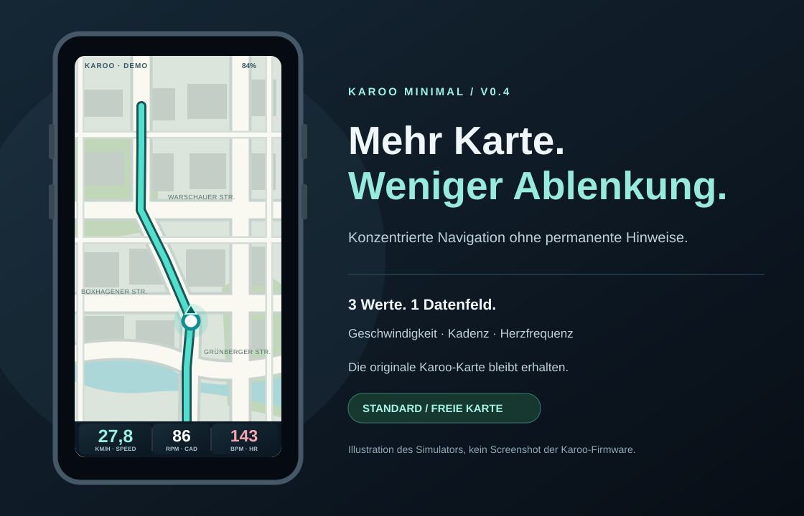
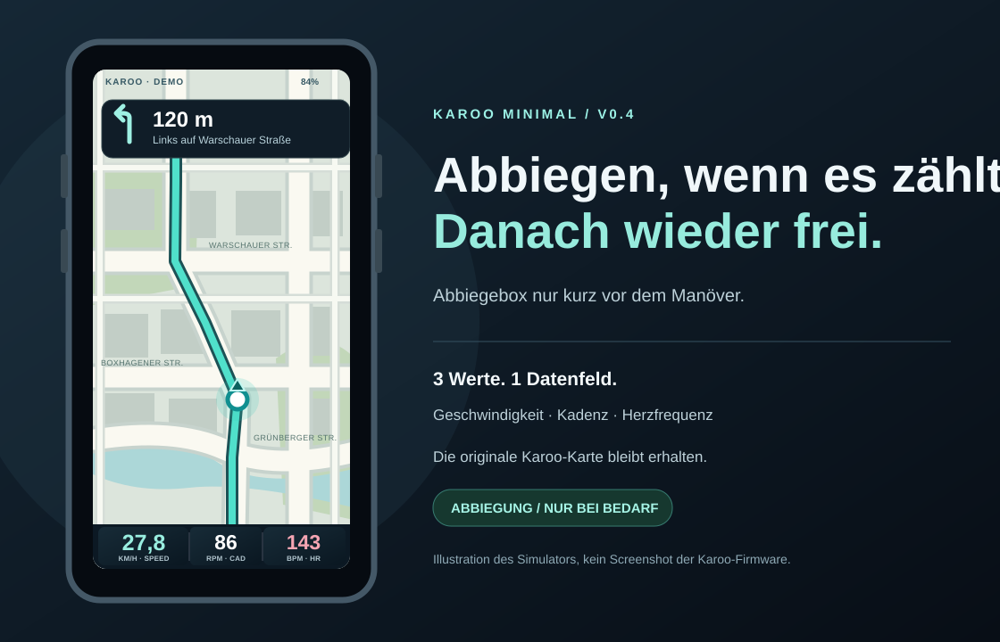

# KAROO / MINIMAL

Ein minimalistisches **3-in-1-Datenfeld** für die originale Navigationskarte des **Hammerhead Karoo (3. Generation)**.

## Aktuelle Vorschau v0.4.0

| Normale Fahrt – freie Karte | Kurz vor der Abbiegung |
| :---: | :---: |
|  |  |

[**Interaktiven Simulator testen**](docs/simulator.html) · [Vorschauen groß ansehen](docs/preview.html)

> **Status: v0.4.0 – Debug-APK erfolgreich in GitHub Actions kompiliert, Hardwaretest ausstehend.** Die Bilder sind **Illustrationen** der Simulation, keine Screenshots der Original-Firmware. Die Extension zeichnet nur ihre eigene Datenleiste; die native Karoo-Navigation übernimmt die Karte und die Abbiegehinweise.

## Interaktive Browser-Simulation

[Simulator öffnen (Datei auf GitHub)](docs/simulator.html) · [HTML direkt herunterladen](https://raw.githubusercontent.com/derB3rt/karoo-minimal/main/docs/simulator.html)

Der eigenständige Simulator enthält eine schematische, animierte Karte im **480 × 800 px Karoo-Displayformat** und einen Navigationshinweis. Geschwindigkeit, Kadenz und Herzfrequenz lassen sich verändern, Sensoren trennen, Nachtmodus umschalten sowie Navigation und Zoom steuern. **Seit Simulator v0.4**: Der Abbiegehinweis ist normalerweise ausgeblendet und erscheint erst auf den letzten **180 m vor der Demo-Abbiegung**; der neue Streckenpositions-Regler erlaubt, genau diesen Moment zu testen. Die Demo-Datenleiste ist nur noch **72 statt 102 Pixel** hoch. Er lässt sich nach dem Herunterladen **offline im Browser** öffnen.

Es handelt sich **nicht** um emulierte Hammerhead-Firmware und **nicht** um einen Test der Android-Extension. Karten, Sensoren und Route sind Demo-Daten.

Optional als Webseite veröffentlichen: In GitHub unter **Settings → Pages** als Quelle **Deploy from a branch**, Branch **main**, Ordner **/docs** wählen. Danach ist der Simulator unter `https://derb3rt.github.io/karoo-minimal/simulator.html` erreichbar (erst nach erfolgreicher Pages-Bereitstellung).

## APK automatisch mit GitHub Actions bauen

[**Aktuelle APK v0.4.0 als GitHub-Release herunterladen**](https://github.com/derB3rt/karoo-minimal/releases/tag/v0.4.0-beta.1) · [Build-Workflow ansehen](.github/workflows/build-apk.yml) · [Actions-Bereich öffnen](https://github.com/derB3rt/karoo-minimal/actions)

Der Workflow installiert Android SDK 35 und Gradle 8.9, baut `:app:assembleDebug`, lädt `karoo-minimal-v0.4.0-debug-apk` als GitHub-Actions-Artefakt hoch und veröffentlicht die Datei `Karoo-Minimal-v0.4.0-debug.apk` im GitHub-Release. **Nur ein erfolgreicher Workflow bedeutet, dass eine installierbare Debug-APK erzeugt wurde.** Die App bleibt bis zum Gerätetest ein Prototyp. Bei Problemen mit der Hammerhead-Abhängigkeit können zusätzliche GitHub-Packages-Leserechte nötig sein.

## Konzept

Die native Karoo-Kartenseite übernimmt Navigation, Karten, Routen und Abbiegehinweise. Diese Extension liefert **ein** grafisches Datenfeld am unteren Kartenrand:

| Wert | Anzeige | Karoo-Quelle |
| --- | --- | --- |
| Geschwindigkeit | 27,8 km/h (türkis, am größten) | `SPEED` |
| Kadenz | 86 rpm (weiß) | `CADENCE` |
| Herzfrequenz | 143 bpm (korallrot) | `HEART_RATE` |

Es gibt keine eigene Karten-App, keinen direkten Bluetooth-Zugriff und keinen Netzwerkverkehr. Sensoren werden wie gewohnt mit dem Karoo verbunden. Nicht verfügbare Sensorwerte werden als „—“ angezeigt.

## Technischer Aufbau

- **Kotlin / Android**, Hammerheads offizielles `karoo-ext`-SDK
- Karoo-`KarooExtension` mit `DataTypeImpl` als grafischem Feld
- Native `RemoteViews`-Anzeige mit drei Kennzahlen
- Live-Werte über Karoo-`OnStreamState.StartStreaming`
- Reine Layoutvorschau in der App (`MainActivity`)
- Zwei aktuelle [Designentwürfe](docs/preview.html) als SVG (mit/ohne Abbiegehinweis)

Die Beschriftungen und Abstände in `field_dashboard.xml` sind gegenüber v0.1.0 jetzt kompakter (Mindesthöhe 48 dp). **Die native Karoo-Oberfläche bestimmt, wie groß der Datenfeldplatz tatsächlich ist.** Abbiegehinweise im echten Gerät werden ausschließlich von Hammerhead gesteuert; die 180-Meter-Schwelle gilt nur im Simulator. Die Breite und Höhe eines grafischen Datenfelds legt die Karoo-Oberfläche fest. Ob die Leiste in der tatsächlichen Kartenansicht gut lesbar ist, müssen wir auf dem Gerät prüfen.

## Build und Installation

Voraussetzungen: Android Studio, JDK 17, Android SDK 35, Gradle 8.9.

1. Projekt in Android Studio öffnen.
2. Für das öffentliche Karoo-Paket auf GitHub Packages sind Zugangsdaten erforderlich: `GPR_USER` und `GPR_TOKEN` als **lokale** Umgebungsvariablen (GitHub-Token mit `read:packages`) oder die Properties `gpr.user` und `gpr.key` in `~/.gradle/gradle.properties`. Keine Zugangsdaten ins Repository schreiben.
3. Wenn `gradlew` fehlt, lokal Gradle 8.9 nutzen oder mit `gradle wrapper --gradle-version 8.9` den Wrapper erzeugen.
4. Gradle Sync und `app:assembleDebug` ausführen. Erwarteter Ausgabeort: `app/build/outputs/apk/debug/app-debug.apk`.
5. Debug-APK über einen für die aktuelle Karoo-OS-Version unterstützten Sideloading-Weg installieren.
6. Im Karoo-Ride-Profil die **Kartenseite** bearbeiten und das grafische Datenfeld **MINIMAL · Speed / Cadence / HR** in einen Datenfeldplatz unten auf der Karte aufnehmen.

**Die Debug-APK wird erfolgreich über GitHub Actions gebaut, ist aber noch nicht auf dem Gerät getestet.** Insbesondere die tatsächliche Feldhöhe, der Kontrast sowie die Sensoranzeige müssen in einem Hardwaretest geprüft werden.

## Struktur

- `app/src/main/java/de/derb3rt/karoominimal/MinimalExtension.kt` – Datenströme und Karoo-Extension
- `app/src/main/res/layout/field_dashboard.xml` – die tatsächliche Datenleiste
- `app/src/main/res/xml/extension_info.xml` – Registrierung als grafisches Feld
- `docs/preview.svg` und `docs/preview.html` – Design-Mock-up, **keine echte Kartenanzeige**

## Inspiration

- [Offizielles Hammerhead SDK](https://github.com/hammerheadnav/karoo-ext)
- [Vin-HkE](https://github.com/maduwatas/Vin-HkE) – mehrere Kennzahlen in einem Feld
- [BigFields](https://github.com/anpaiss/BigFields) – große, gut lesbare Datenfelder
- [Karoo-Profile konfigurieren](https://support.hammerhead.io/hc/en-us/articles/25601814671259-Karoo-OS-Customising-Profiles)

## Lizenz

MIT. Fremde Karten oder Quelltexte werden nicht übernommen.
